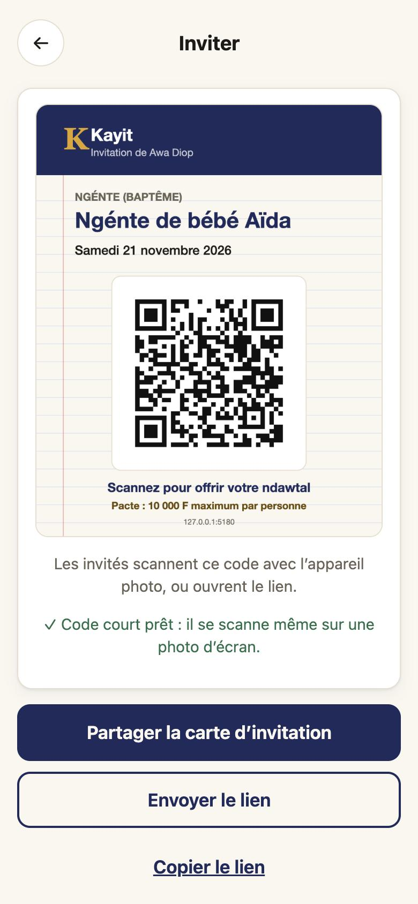
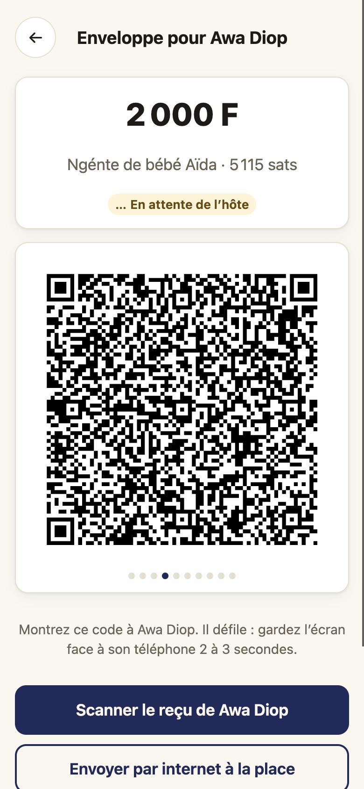
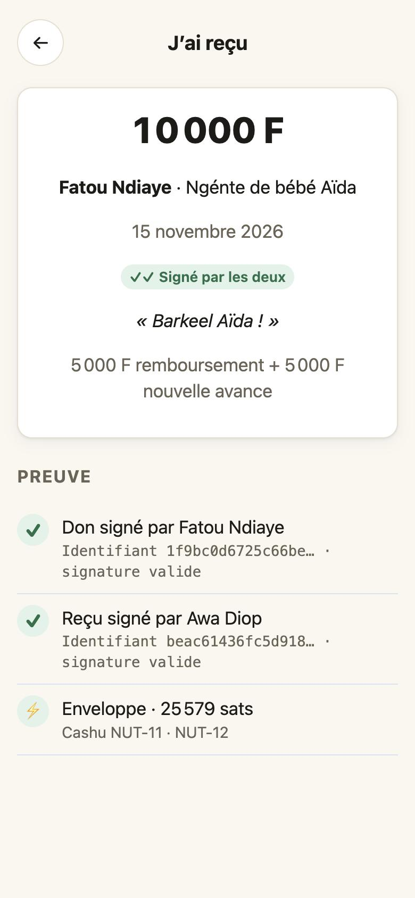
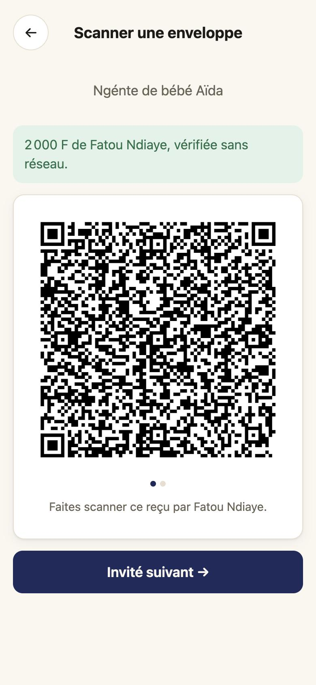
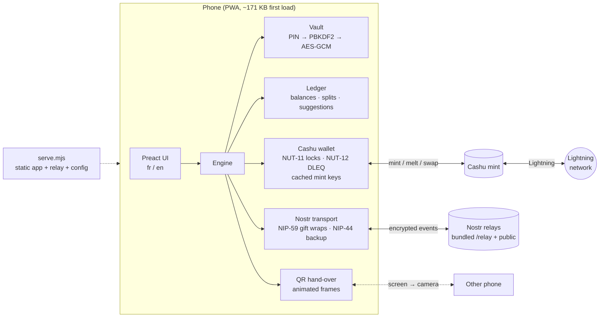
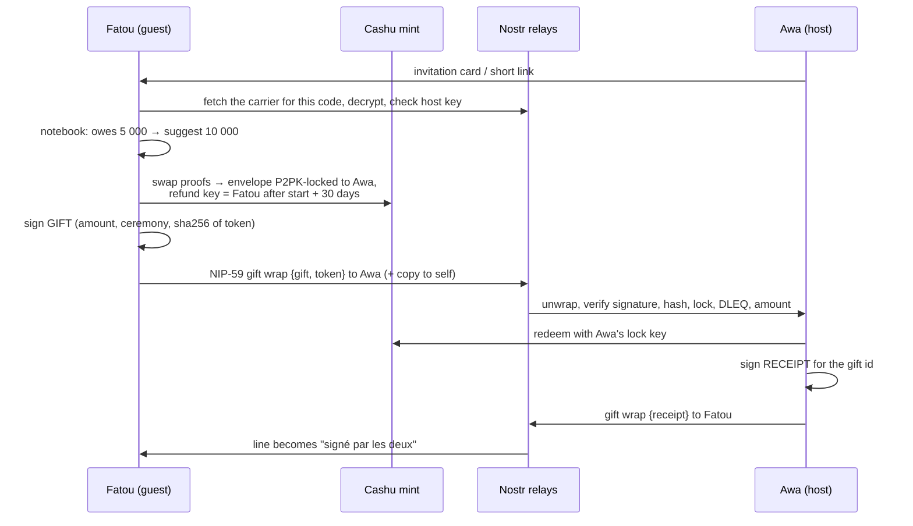
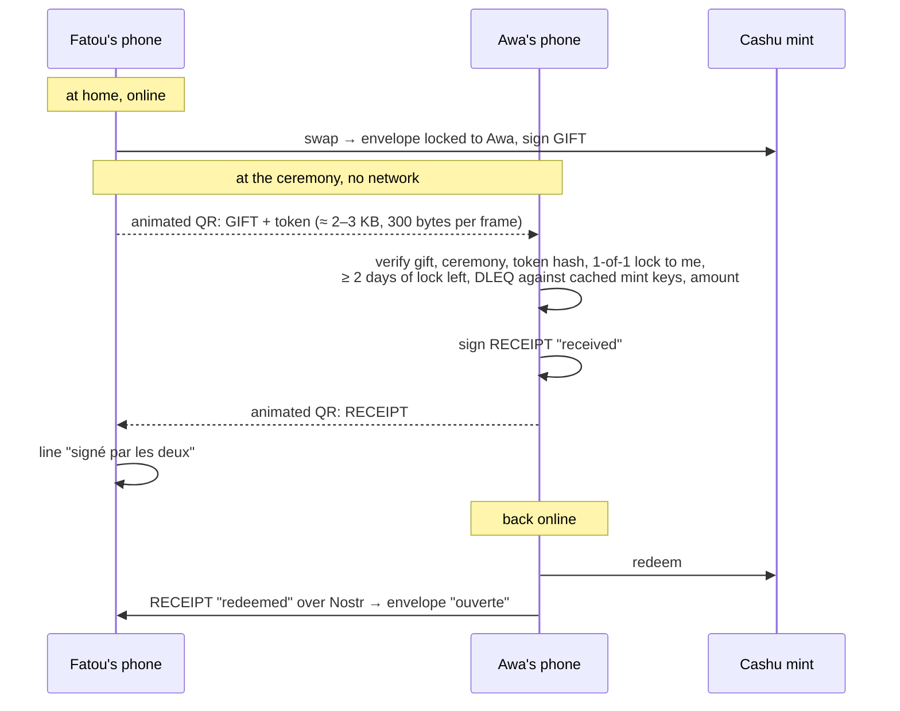

# Kayit — the ndawtal notebook that can't be lost, forged or forgotten

**Kayit** (Wolof *kayit*, "paper") is a phone notebook for **ndawtal**, the gifts that guests bring to Senegalese
family ceremonies — a baby's naming day (*ngénte*), a wedding, a funeral. It has a built‑in Bitcoin wallet
(Cashu ecash over Lightning), and every gift becomes a line signed by **both** the giver and the host — even when
the envelope is handed over in a courtyard with no network.

> Dakar Bitcoin Hack 2026 entry · MIT licence · test mint only (no real sats)

<p>





</p>

---

## The problem

At a ngénte, the mother's friends and relatives arrive with envelopes. Someone — often an aunt or a hired *griot* —
calls out each name and amount, and someone else writes it all in a school exercise book. That book is a
**ledger of debts**: custom says a ndawtal is returned at the giver's own ceremony, usually doubled. Half of the
return pays back what you received; the other half is a new advance that they will owe you.

The book carries real money and real reputations, and it fails in familiar ways:

- **It gets lost**, burned, or stays with one sister. Years of reciprocity disappear with it.
- **It can be disputed.** "I gave you 10 000, not 5 000." Nobody can prove what was said in a noisy courtyard.
- **People forget** what they owe, to whom, and from which ceremony — and returning too little is shaming.
- **Cash is risky** at a crowded event, and relatives abroad cannot hand over an envelope at all.
- **The public calling‑out** (the griot) puts pressure on guests to give more than they can.

Kayit keeps the custom and fixes the book.

## Who it's for

- **Primary user: the host** — usually the mother, or the aunt or sister who keeps the cahier. She runs the
  ceremony, holds the money and loses the most when the book is lost or a gift is disputed.
- **Secondary: the guests**, who have to remember what they owe and to whom, and **relatives abroad** who want
  to take part without sending cash through a third person.
- **Their phone:** a mid‑range Android with WhatsApp, a few GB of data a month, patchy 3G/4G at the ceremony
  itself. French on screen, Wolof spoken.

## Reach (estimate)

Every line below is either sourced or marked as an assumption. The pilot is how the assumptions get measured.

| | Figure | Basis |
|---|---|---|
| Naming ceremonies a year in Senegal (one per birth) | **≈ 530 000 – 550 000** | World Bank crude birth rate 29.4 per 1 000 in 2023 ([FRED](https://fred.stlouisfed.org/series/SPDYNCBRTINSEN)) × ≈ 18 M people — my arithmetic |
| Guests bringing a ndawtal to one ngénte | **30 – 80** | **Assumption**, not surveyed; first thing the pilot measures |
| Gift lines a year, naming ceremonies alone | **≈ 16 – 44 million** | Product of the two lines above; weddings and funerals come on top |
| People in Senegal online | **11.3 M (60.6 %)** | [DataReportal, Digital 2025: Senegal](https://datareportal.com/reports/digital-2025-senegal) |
| …of whom use WhatsApp | **most‑used platform; ≈ 85 % modelled** | [Adweknow 2025](https://adweknow.com/en/senegalese-and-ivorian-television-channels-conquer-social-media/); [Yazi](https://www.askyazi.com/articles/whatsapp-penetration-across-africa-statistics-by-country) (a model, not a survey) |
| Pilot | **1 neighbourhood association, ≈ 40 households, ≈ 10 ceremonies in 6 months** | **Assumption**: target, measured with the metrics below |

**Why WhatsApp is the channel.** Across eight middle‑income countries surveyed by Pew in 2023, including Kenya,
Nigeria and South Africa, a median of 73 % of adults use WhatsApp
([Pew, 2024](https://www.pewresearch.org/short-reads/2024/03/22/whatsapp-and-facebook-dominate-the-social-media-landscape-in-middle-income-nations/)).
GeoPoll's 2025 survey of Ghana, Kenya, Nigeria and Uganda puts WhatsApp first at 90 %
([GeoPoll](https://www.geopoll.com/blog/smartphone-and-social-media-usage-2025/)). Kayit does not depend on it,
though: the invitation card goes through the phone's own share sheet (WhatsApp, Telegram, SMS, Bluetooth), can be
printed, and the link opens in any browser.

## What it does

| | |
|---|---|
| **Host a ceremony** | Name, date, type and an optional *pacte* cap ("no gift above 10 000 F") that the app enforces for guests. |
| **Invitation card** | One image — cahier paper, title, date, a **small QR** — to post in a WhatsApp chat or Status, print, or show at the door. The QR holds a 73‑character link (37 × 37 modules) instead of the full signed ceremony (121 × 121), so it scans from a photo of a screen. |
| **Give** | The app reads your notebook and suggests the custom amount: *you owe Awa 5 000 → return 10 000 = 5 000 repaid + 5 000 new advance*. Give by **ecash envelope** (sats locked to the host) or declare a **cash** gift the host confirms. |
| **Hand over in person** | Prepare the envelope at home. At the ceremony, the host's phone scans it from your screen as a short QR animation — **no network on either phone**. The host's phone checks it, signs the receipt on the spot, and cashes the sats when the network is back. |
| **Live board** | The host sees arrivals in real time. Optional *griot* mode reads names and amounts aloud; optional *sutura* (discretion) mode hides amounts on screen. |
| **The cahier** | Who owes whom, by person or line by line, with each return split into repayment and advance. Old paper lines can be typed in. |
| **Proof** | Every digital line shows the giver's signature and the host's receipt, checked live on the phone. |
| **Ma caisse** | A real Bitcoin wallet: top up over Lightning, send envelopes, withdraw to any Lightning wallet, reclaim an envelope the host never opened. |
| **Never lost** | 12 words restore the whole notebook and the open envelopes on a new phone, from Nostr relays. |

Everything is in French first (English available), amounts in **francs CFA**, sats shown second.

## Try it

**Hosted MVP:** <https://ashank-crazy.github.io/kayit/> (static build on the public test mint and public relays)

On the welcome screen tap **Essayer la démo**. It creates two notebooks on this phone:

| Notebook | PIN | Story |
|---|---|---|
| **Awa Diop** | `1111` | hosts *Ngénte de bébé Aïda* next Saturday, cap 10 000 F; invited to a wedding |
| **Fatou Ndiaye** | `2222` | owes Awa 5 000 F from an old paper line; her caisse is funded from the test mint |

Open Awa in one tab and Fatou in a second tab (one tab per notebook).

1. **Online gift.** As Fatou, open the ngénte, accept the suggested 10 000 F and send the envelope. Awa's board
   lights up, her caisse grows, and both cahiers show the line *signé par les deux* with the 5 000 + 5 000 split.
2. **Invitation card.** As Awa, open the ceremony → *Inviter*. The card and its short code appear; *Partager la
   carte d'invitation* opens the share sheet on a phone (or saves the PNG on a computer).
3. **Hand‑over with no network.** As Fatou, on the ngénte choose *Préparer pour remettre en main propre*. As Awa,
   open the board → *📷 Scanner une enveloppe*. Awa's phone accepts the envelope and shows a receipt; Fatou taps
   *Scanner le reçu*. Two tabs on one computer cannot film each other, so in demo notebooks the QR frames also
   pass between tabs on the same computer; on two phones the camera reads them.

<p>


</p>

## Run it

**One command (Docker):** app, Nostr relay and a local Cashu mint (FakeWallet: invoices pay themselves).

```bash
docker compose up --build
```

Then open <http://localhost:8080>.

**Without Docker** (Node 22+), using the public test mint:

```bash
npm install && npm start
```

**Development:**

```bash
npm run dev
```

**Tests:**

```bash
npm test
```

```bash
npm run test:live
```

`npm test` runs the unit tests: money, keys, vault, ledger maths, protocol tamper checks, compact invitations
(including a forged carrier), QR frames read back by a real QR decoder, and backups split into parts.
`npm run test:live` runs the whole happy path for real against a local relay and a Cashu mint (the public test
mint, or the Docker one with `KAYIT_MINT=http://localhost:3338`). Two engines play host and guest through a
Lightning top‑up, a locked envelope, a receipt, a cash gift, an **in‑person hand‑over with every mint request
blocked** (a stranger's phone and a swapped token are refused), cashing it when the network returns, and a
restore from 12 words.

Server settings: `PORT`, `KAYIT_MINT`, `KAYIT_RELAYS` (extra relays, comma‑separated), `RELAY_DATA`.
On a static host (GitHub Pages, any CDN), edit `kayit-config.json` next to `index.html` to change the mint or relays.

## How it works



### A gift, step by step



### Hand‑over with no network



The envelope is compressed (deflate) with the Cashu token in its raw CBOR form, then cut into frames
`KY1:<id>:<i>:<n>:<data>` shown at about four per second. A typical envelope is 4–12 frames, one loop in 1–3 s.
The id is a hash of the whole payload, so frames from two envelopes never mix and a corrupted transfer is
rejected. Phones with a built‑in QR reader (`BarcodeDetector`) use it; others load a small fallback reader
once, which the offline cache keeps.

### Compact invitation

The short link `…/#/i/<code>` carries 24 bytes: a random 16‑byte secret and the first 8 bytes of the host's key.
From the secret, both sides derive a throwaway signing key and an encryption key. The host publishes the signed
ceremony on relays, NIP‑44 encrypted with that key and signed by the throwaway key (kind 9333). The guest's phone
fetches it, decrypts it, verifies the host's signature on the ceremony and checks that the host key starts with
the 8 bytes in the code. A relay never learns the ceremony; a forged carrier needs a 2⁶⁴ search. The long link,
with the full signed ceremony in the `#fragment`, is still offered and works with no relay at all.

### Protocol

| Event | Kind | Signed by | Travels | Content |
|---|---|---|---|---|
| Ceremony | 31923 (NIP‑52) | host | long link fragment, or inside an invite carrier | title, type, date, host lock key, mint, relays, cap |
| Invite carrier | 9333 | throwaway key from the code | relays | the ceremony, NIP‑44 encrypted with a key from the code |
| Gift | 9330 | giver | inside a gift wrap, or an animated QR | host, ceremony, amount (XOF), method, sats, `sha256(token)`, message |
| Receipt | 9331 | host | inside a gift wrap, or an animated QR | gift id, giver, amount, `redeemed` or `received` |
| Envelope | 9332 rumor | sender | NIP‑59 gift wrap (kind 1059) | `{gift, token}`, `{receipt, gift}` or `{reject}` |
| Backup | 30078, `d=kayit:backup:v2` + `:v2:<i>` | owner | relays | the whole notebook, compressed, split into ≤ 30 KB parts, each NIP‑44 encrypted to yourself |

A line is **co‑signed** when a valid gift and a valid receipt for it are both present. Neither side can inflate,
deny or invent it afterwards. Relays only ever see gift wraps addressed to a key, encrypted carriers and
encrypted backups. A receipt is `redeemed` once the host has cashed an envelope, and `received` for cash, or for
an envelope checked offline and not cashed yet.

Keys come from one 12‑word NIP‑06 seed: account 0 is the Nostr identity, account 1 is the ecash lock key. The
envelope is locked to the host's lock key (NUT‑11) with the giver's lock key as refund key after
`ceremony start + 30 days`, so an unopened envelope always comes back.

## Security by design

The full threat model is in [docs/THREAT_MODEL.md](docs/THREAT_MODEL.md). In short:

- **Keys never leave the phone.** The seed and a random data key are sealed with the PIN (PBKDF2‑SHA256, 310 000
  rounds → AES‑256‑GCM); the whole state is encrypted with the data key at rest. After 5 wrong PINs the phone
  waits 30 s, doubling with each further miss, across reloads and tabs.
- **Least privilege on money.** An envelope can be opened only by the host's key and only refunded to the giver.
  A stolen link, relay message or photo of the QR is worthless to anyone else.
- **Verify before touching the mint — online or not.** Inbound gifts are checked for signature, sender = signer,
  ceremony match, token hash, mint, lock key, DLEQ proof and amount before redemption. Offline, the host's phone
  also requires a 1‑of‑1 lock with at least 2 days left, and checks DLEQ against the mint keys it cached while
  online. Tampered events, swapped tokens and envelopes for another host fail; tests prove each one.
- **Short codes that can't be hijacked.** The host key prefix in the invite code means a fake carrier on a relay
  is ignored.
- **Validated inputs.** Amounts are safe integers with an upper bound, text is length‑capped and stripped of control
  characters, invitations are parsed and verified before display, the cap is enforced on send, QR frames are
  size‑ and count‑limited.
- **No PII in logs or servers.** The bundled server logs nothing per request. The relay stores only wrapped
  events. Long invitations live in the URL fragment, which browsers never send to servers. `Referrer-Policy:
  no-referrer`, a strict CSP, `X-Frame-Options: DENY`, camera allowed for this origin only.
- **Small supply chain.** Six runtime dependencies in the app (cashu‑ts, nostr‑tools, @noble/hashes, preact, a QR
  encoder, and a QR reader loaded only on phones without a built‑in one) and one on the server (ws). No
  analytics, no CDN, no web fonts.

## Built for low bandwidth and mid‑range phones

Lighthouse 12.6, mobile preset (simulated slow 4G, 4× CPU slowdown), production build on the bundled server:

| Performance | Accessibility | Best practices | First paint | Largest paint | Blocking time | Layout shift | First load |
|---|---|---|---|---|---|---|---|
| **98** | **100** | **100** | 1.8 s | 2.0 s | 0 ms | 0 | 171 KiB |

- **No network needed at the ceremony** for envelopes prepared at home: the courtyard is where the signal is worst.
- **171 KiB on first load**, then served from the offline cache. System fonts, no images except one SVG icon.
  The QR reader fallback (47 KB) loads only on phones that need it. The bundled server gzips everything.
- **Invitation card drawn on the phone** (canvas, no download). Its QR still decodes after the card is shrunk to
  480 px wide and saved as a JPEG at quality 0.3 (23 KB), the kind of squeeze a chat app or a forwarded Status
  applies.
- **Installable PWA** with an offline shell; the notebook is readable with no network.
- **Phone‑first layout** at 360–400 px, large tap targets, a numeric PIN pad, `inputmode=numeric` on amounts.
- **Forgiving inputs**: `10 000`, `10.000 F`, `10k`, `2500fcfa` are all understood.
- **Sends finish on the first relay that accepts**, so one slow or blocked relay never stalls the gift.
- **Rate fallback**: the XOF/BTC rate comes from mempool.space (XOF is pegged at 655.957 per euro) and falls back
  to a fixed rate offline, rounding sats up so the host never receives less than announced.

## Honest limits

- **Test mint only.** Everything runs on test sats. A real deployment needs a trusted mint (or a federation) and
  a licensed CFA on/off ramp.
- **The mint is custodial** while sats sit in ecash. That is the price of instant, private, offline‑capable
  envelopes; amounts per ceremony are small, and users can withdraw to their own Lightning wallet at any time.
- **An offline receipt is a promise checked by maths, not by the mint.** The host's phone has verified that the
  envelope is valid and locked to her, but the mint has not seen it yet. If the host never reconnects before the
  lock ends, the giver can take it back. Kayit refuses envelopes with less than 2 days of lock left.
- **Short codes need a relay** to keep the encrypted carrier. If none does, the long link still works.
- **The QR animation needs a bright screen** and a camera that focuses at about 20 cm. Every frame is tested
  against a real QR decoder and the full hand‑over runs between tabs, but it has not yet been field‑tested on a
  range of phone cameras in daylight; that is the first thing to check in the pilot.
- **A short PIN can be brute‑forced** by someone who copies the phone's storage. Device lock + PBKDF2 slow this
  down; it does not stop a determined attacker with the phone.
- **Cash and paper lines are only as true as the people who confirm them.** Cash gifts need the host's receipt;
  typed‑in paper lines are marked *papier* and never shown as proven.
- **One open tab per notebook** to avoid two writers on one wallet.

## Metrics to track in a pilot

- Ceremonies hosted per month, guests per ceremony (replaces the 30–80 assumption above), share of gifts given by
  envelope online, envelope in person, and cash
- Invitation cards shared per ceremony, and share of guests who open them
- Share of lines co‑signed within 24 h, and envelopes reclaimed (unopened) — a health signal for hosts
- Hand‑overs: time from showing the QR to a receipt, and envelopes refused (by reason)
- Notebooks restored from 12 words, and time to restore
- Disputes raised by hosts (rejected cash gifts) per 100 gifts
- Time from opening the invitation to a sent gift, on a 3G connection
- Diaspora share: gifts sent from outside Senegal

## Next iteration

1. **Wolof interface and voice**: Wolof labels, and the griot voice in Wolof for the board.
2. **Printed envelopes** for guests without a smartphone: the same locked envelope printed as a sheet of small
   QRs. It is safe on paper because only the host's key can open it.
3. **Wallet restore by seed** (NUT‑13 deterministic secrets / NIP‑60) so even unbacked‑up ecash survives a lost phone.
4. **CFA on/off ramp** with a local Lightning exchange so families can top up from mobile money and cash out.
5. **Shared family notebook**: several sisters co‑host one ceremony and see one board.
6. **Crash‑safe swaps**: record pending mint operations before sending, recover on restart.

## Local impact

Ndawtal and its cousins (*tontines*, *tours de famille*) are how many Senegalese households, mostly women, save,
borrow and insure each other. Kayit does not try to replace that system with a bank account. It gives the
existing one a memory that survives lost books, a proof that settles disputes, a way for relatives abroad to take
part, an envelope that works where the network doesn't, and a *sutura* mode and a cap so the ceremony puts less
pressure on guests. The pilot goal is one neighbourhood association hosting its next ngéntes on Kayit, measured
with the metrics above.

Background reading: Beth Buggenhagen, *Muslim Families in Global Senegal: Money Takes Care of Shame* (Indiana
University Press, 2012), on women's ceremonial exchange in Senegal.

## Project layout

```
src/core/      money, keys, vault, protocol, ledger, wallet (Cashu), transport (Nostr), airgap (QR frames), zip, engine
src/app/       config, profiles and sessions, demo seed, i18n (fr/en)
src/ui/        screens: welcome, home, host, give, cahier, caisse, settings, airgap (hand‑over), card (invitation image)
server/        serve.mjs (static app + config + relay, gzip), relay.mjs (tiny NIP‑01 relay)
tests/         unit tests and the live end‑to‑end test
docs/          threat model, submission text, screenshots
```

## Licence

MIT — see [LICENSE](LICENSE).
