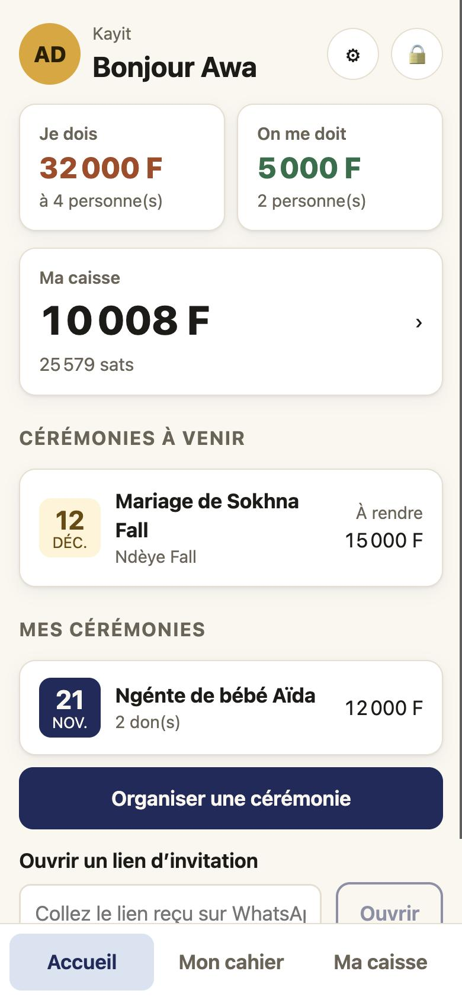
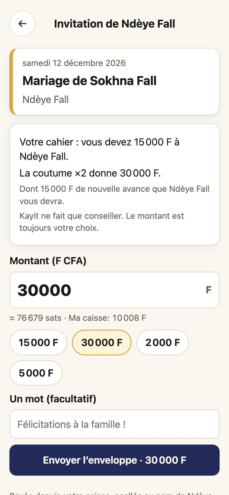
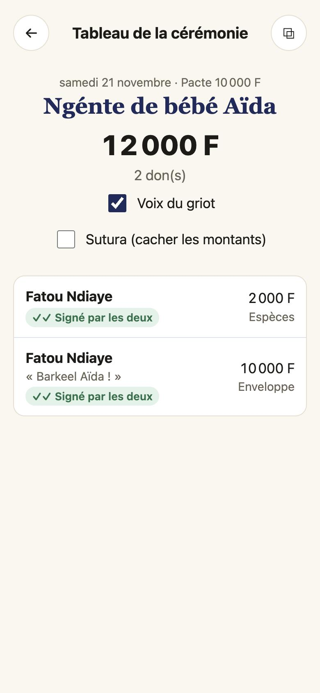
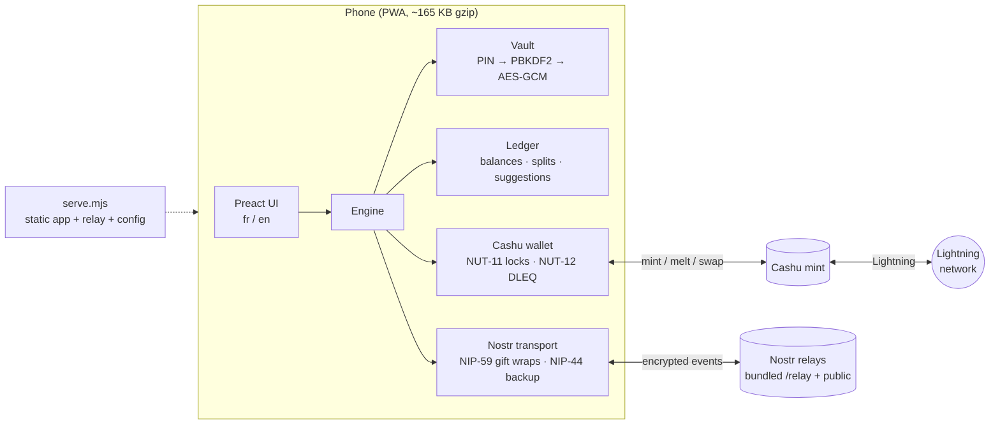
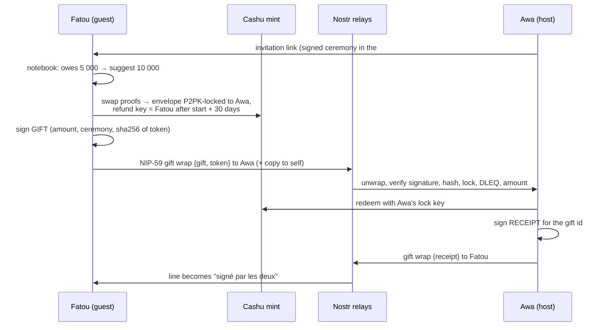

# Kayit — the ndawtal notebook that can't be lost, forged or forgotten

**Kayit** (Wolof *kayit*, "paper") is a phone notebook for **ndawtal**, the gifts that guests bring to Senegalese
family ceremonies — a baby's naming day (*ngénte*), a wedding, a funeral. It has a built‑in Bitcoin wallet
(Cashu ecash over Lightning), and every gift becomes a line signed by **both** the giver and the host.

> Dakar Bitcoin Hack 2026 entry · MIT licence · test mint only (no real sats)

<p>




</p>

---

## The problem

At a ngénte, the mother's friends and relatives arrive with envelopes. Someone — often an aunt or a hired *griot* —
calls out each name and amount, and someone else writes it all in a school exercise book. That book is a
**ledger of debts**: custom says a ndawtal is returned at the giver's own ceremony, usually doubled. Half of the
return pays back what you received; the other half is a new advance that they will owe you.

The book carries real money and real reputations, and it fails in familiar ways:

- **It gets lost**, burned, or stays with one sister. Years of reciprocity disappear with it.
- **It can be disputed.** "I gave you 10 000, not 5 000." Nobody can prove what was said in a noisy courtyard.
- **People forget** what they owe, to whom, and from which ceremony — and returning too little is shaming.
- **Cash is risky** at a crowded event, and relatives abroad cannot hand over an envelope at all.
- **The public calling‑out** (the griot) puts pressure on guests to give more than they can.

Kayit keeps the custom and fixes the book.

## What it does

| | |
|---|---|
| **Host a ceremony** | Name, date, type and an optional *pacte* cap ("no gift above 10 000 F") that the app enforces for guests. Share one link or QR on WhatsApp. |
| **Give** | The app reads your notebook and suggests the custom amount: *you owe Awa 5 000 → return 10 000 = 5 000 repaid + 5 000 new advance*. Give by **ecash envelope** (sats locked to the host) or declare a **cash** gift the host confirms. |
| **Live board** | The host sees arrivals in real time. Optional *griot* mode reads names and amounts aloud; optional *sutura* (discretion) mode hides amounts on screen. |
| **The cahier** | Who owes whom, by person or line by line, with each return split into repayment and advance. Old paper lines can be typed in. |
| **Proof** | Every digital line shows the giver's signature and the host's receipt, checked live on the phone. |
| **Ma caisse** | A real Bitcoin wallet: top up over Lightning, send envelopes, withdraw to any Lightning wallet, reclaim an envelope the host never opened. |
| **Never lost** | 12 words restore the whole notebook and the open envelopes on a new phone, from Nostr relays. |

Everything is in French first (English available), amounts in **francs CFA**, sats shown second.

## Try it

**Hosted MVP:** <https://ashank-crazy.github.io/kayit/> (static build on the public test mint and public relays)

On the welcome screen tap **Essayer la démo**. It creates two notebooks on this phone:

| Notebook | PIN | Story |
|---|---|---|
| **Awa Diop** | `1111` | hosts *Ngénte de bébé Aïda* next Saturday, cap 10 000 F; invited to a wedding |
| **Fatou Ndiaye** | `2222` | owes Awa 5 000 F from an old paper line; her caisse is funded from the test mint |

Open Awa in one tab and Fatou in a second tab (one tab per notebook). As Fatou, open the ngénte, accept the
suggested 10 000 F and send the envelope. Awa's board lights up, her caisse grows, and both cahiers show the
line *signé par les deux* with the 5 000 + 5 000 split.

## Run it

**One command (Docker):** app, Nostr relay and a local Cashu mint (FakeWallet: invoices pay themselves).

```bash
docker compose up --build
```

Then open <http://localhost:8080>.

**Without Docker** (Node 22+), using the public test mint:

```bash
npm install && npm start
```

**Development:**

```bash
npm run dev
```

**Tests:**

```bash
npm test
```

```bash
npm run test:live
```

`npm test` runs the unit tests (money, keys, vault, protocol tamper checks, ledger maths). `npm run test:live`
runs the whole happy path for real: a local relay and the public test mint. Two engines play host and guest
through a Lightning top‑up, a locked envelope, a receipt, a cash gift and a restore from 12 words.

Server settings: `PORT`, `KAYIT_MINT`, `KAYIT_RELAYS` (extra relays, comma‑separated), `RELAY_DATA`.
On a static host (GitHub Pages, any CDN), edit `kayit-config.json` next to `index.html` to change the mint or relays.

## How it works



### A gift, step by step



### Protocol

| Event | Kind | Signed by | Travels | Content |
|---|---|---|---|---|
| Ceremony | 31923 (NIP‑52) | host | invitation link fragment only | title, type, date, host lock key, mint, relays, cap |
| Gift | 9330 | giver | inside a gift wrap | host, ceremony, amount (XOF), method, sats, `sha256(token)`, message |
| Receipt | 9331 | host | inside a gift wrap | gift id, giver, amount, `redeemed` or `received` |
| Envelope | 9332 rumor | sender | NIP‑59 gift wrap (kind 1059) | `{gift, token}`, `{receipt, gift}` or `{reject}` |
| Backup | 30078, `d=kayit:backup:v1` | owner | relays | the whole notebook, NIP‑44 encrypted to yourself |

A line is **co‑signed** when a valid gift and a valid receipt for it are both present. Neither side can inflate,
deny or invent it afterwards. Relays only ever see gift wraps addressed to a key, and encrypted backups.

Keys come from one 12‑word NIP‑06 seed: account 0 is the Nostr identity, account 1 is the ecash lock key. The
envelope is locked to the host's lock key (NUT‑11) with the giver's lock key as refund key after
`ceremony start + 30 days`, so an unopened envelope always comes back.

## Security by design

The full threat model is in [docs/THREAT_MODEL.md](docs/THREAT_MODEL.md). In short:

- **Keys never leave the phone.** The seed and a random data key are sealed with the PIN (PBKDF2‑SHA256, 310 000
  rounds → AES‑256‑GCM); the whole state is encrypted with the data key at rest. After 5 wrong PINs the phone
  waits 30 s, doubling with each further miss, across reloads and tabs.
- **Least privilege on money.** An envelope can be opened only by the host's key and only refunded to the giver.
  A stolen link or relay message is worthless to anyone else.
- **Verify before touching the mint.** Inbound gifts are checked for signature, sender = signer, ceremony match,
  token hash, mint, lock key, DLEQ proof and amount before redemption. Tampered events fail; a test proves it.
- **Validated inputs.** Amounts are safe integers with an upper bound, text is length‑capped and stripped of control
  characters, invitations are parsed and verified before display, the cap is enforced on send.
- **No PII in logs or servers.** The bundled server logs nothing per request. The relay stores only wrapped
  events. Invitations live in the URL fragment, which browsers never send to servers. `Referrer-Policy:
  no-referrer`, a strict CSP, `X-Frame-Options: DENY`.
- **Small supply chain.** Five runtime dependencies in the app (cashu‑ts, nostr‑tools, @noble/hashes, preact, a QR
  encoder) and one on the server (ws). No analytics, no CDN, no web fonts.

## Built for low bandwidth and mid‑range phones

- **~165 KB gzip** for the whole app (JS + CSS + HTML), system fonts, no images except one SVG icon.
- **Installable PWA** with an offline shell; the notebook is readable with no network.
- **Phone‑first layout** at 360–400 px, large tap targets, a numeric PIN pad, `inputmode=numeric` on amounts.
- **Forgiving inputs**: `10 000`, `10.000 F`, `10k`, `2500fcfa` are all understood.
- **Sends finish on the first relay that accepts**, so one slow or blocked relay never stalls the gift.
- **Rate fallback**: the XOF/BTC rate comes from mempool.space (XOF is pegged at 655.957 per euro) and falls back
  to a fixed rate offline, rounding sats up so the host never receives less than announced.

## Honest limits

- **Test mint only.** Everything runs on test sats. A real deployment needs a trusted mint (or a federation) and
  a licensed CFA on/off ramp.
- **The mint is custodial** while sats sit in ecash. That is the price of instant, private, offline‑capable
  envelopes; amounts per ceremony are small, and users can withdraw to their own Lightning wallet at any time.
- **A short PIN can be brute‑forced** by someone who copies the phone's storage. Device lock + PBKDF2 slow this
  down; it does not stop a determined attacker with the phone.
- **Cash and paper lines are only as true as the people who confirm them.** Cash gifts need the host's receipt;
  typed‑in paper lines are marked *papier* and never shown as proven.
- **The invitation QR is dense** (it carries the full signed ceremony). A compact encoding is next.
- **One open tab per notebook** to avoid two writers on one wallet.

## Metrics to track in a pilot

- Ceremonies hosted per month, guests per ceremony, share of gifts given by envelope vs cash
- Share of lines co‑signed within 24 h, and envelopes reclaimed (unopened) — a health signal for hosts
- Notebooks restored from 12 words, and time to restore
- Disputes raised by hosts (rejected cash gifts) per 100 gifts
- Time from opening the invitation to a sent gift, on a 3G connection
- Diaspora share: gifts sent from outside Senegal

## Next iteration

1. **Compact invitations**: a short code that resolves to the signed ceremony on relays, so the QR scans at a glance.
2. **Wallet restore by seed** (NUT‑13 deterministic secrets / NIP‑60) so even unbacked‑up ecash survives a lost phone.
3. **Wolof interface and voice**: Wolof labels, and the griot voice in Wolof for the board.
4. **CFA on/off ramp** with a local Lightning exchange so families can top up from mobile money and cash out.
5. **Shared family notebook**: several sisters co‑host one ceremony and see one board.
6. **Crash‑safe swaps**: record pending mint operations before sending, recover on restart.

## Local impact

Ndawtal and its cousins (*tontines*, *tours de famille*) are how many Senegalese households, mostly women, save,
borrow and insure each other. Kayit does not try to replace that system with a bank account. It gives the
existing one a memory that survives lost books, a proof that settles disputes, a way for relatives abroad to take
part, and a *sutura* mode and a cap so the ceremony puts less pressure on guests. The pilot goal is one
neighbourhood association hosting its next ngéntes on Kayit, measured with the metrics above.

Background reading: Beth Buggenhagen, *Muslim Families in Global Senegal: Money Takes Care of Shame* (Indiana
University Press, 2012), on women's ceremonial exchange in Senegal.

## Project layout

```
src/core/      money, keys, vault, protocol, ledger, wallet (Cashu), transport (Nostr), engine
src/app/       config, profiles and sessions, demo seed, i18n (fr/en)
src/ui/        screens: welcome, home, host, give, cahier, caisse, settings
server/        serve.mjs (static app + config + relay), relay.mjs (tiny NIP‑01 relay)
tests/         unit tests and the live end‑to‑end test
docs/          threat model, submission text, screenshots
```

## Licence

MIT — see [LICENSE](LICENSE).
